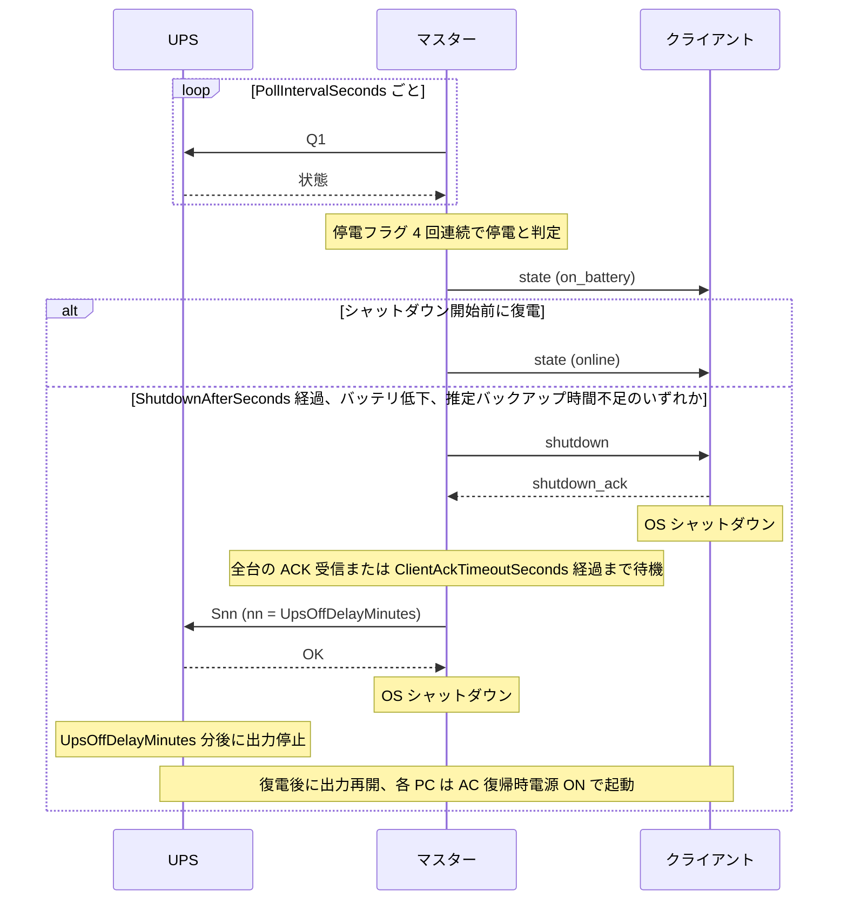

# omronupsd

OMRON BW55T 用の停電監視・連動シャットダウンサービス（Windows）。PowerAttendant の代替。

動作確認環境は BW55T + Windows 11 のみです。

## 構成

| 役割 | 台数 | 内容 |
| --- | --- | --- |
| マスター | 1 | UPS と USB 接続。停電判定とシャットダウン指示を行う |
| クライアント | 任意 | マスターから LAN 経由でシャットダウン指示を受ける |

## 停電時の動作

1. UPS の停電フラグが 4 回連続（既定 2 秒間隔）で立った時点で停電と判定。UPS のセルフテスト中は判定しない
2. 以下のいずれかでシャットダウンを開始。開始後は復電しても中止しない
   - 停電から `ShutdownAfterSeconds` 秒経過
   - UPS のバッテリ低下フラグ検出
   - UPS の推定バックアップ時間が `MinRuntimeMinutes` 分未満
3. マスターは以下の順で処理
   1. 全クライアントへシャットダウン指示
   2. UPS へ `UpsOffDelayMinutes` 分後の出力停止を指示
   3. 自機をシャットダウン
4. 復電すると UPS が出力を再開。各 PC の BIOS で AC 復帰時電源 ON を有効にしておくと自動起動



クライアントはマスターとの通信が途絶しても単独ではシャットダウンしません。シャットダウン開始後にマスターへ接続したクライアントには、接続時にシャットダウンを指示します。

## ビルド

.NET 10 SDK と Inno Setup 6 が必要です。

```powershell
dotnet publish OmronUpsd -c Release -o publish
iscc installer\omronupsd.iss
```

`dist\omronupsd-<バージョン>-setup.exe` を生成します。

## 設定

`appsettings.json` の `OmronUpsd` セクション。

| キー | 既定値 | 説明 |
| --- | --- | --- |
| `Role` | `Master` | `Master` / `Client` |
| `SharedKey` | なし | マスター・クライアント間の認証鍵。全台共通、16 文字以上 |
| `DryRun` | `true` | UPS 停止と OS シャットダウンを実行せずログ出力のみ。マスターの設定はクライアントにも適用 |
| `Master.ListenAddress` / `Master.ListenPort` | `0.0.0.0` / `8771` | クライアント接続の待受 |
| `Master.StatusPort` | `8770` | ステータス API のポート。127.0.0.1 のみ |
| `Master.ShutdownAfterSeconds` | `60` | 停電判定からシャットダウン開始まで（秒、0〜36000）。この値と `UpsOffDelayMinutes` の合計が、負荷に対する UPS のバックアップ時間内に収まる値とする |
| `Master.UpsOffDelayMinutes` | `3` | 出力停止指示から UPS 出力停止まで（分、1〜30）。全台のシャットダウン完了に必要な時間以上とする |
| `Master.MinRuntimeMinutes` | `6` | 推定バックアップ時間がこれを下回ると即シャットダウン（分）。`UpsOffDelayMinutes` より大きい値とする |
| `Master.ClientAckTimeoutSeconds` | `15` | シャットダウン指示に対するクライアント応答の待ち時間（秒） |
| `Master.PollIntervalSeconds` | `2` | UPS 状態の取得間隔（秒） |
| `Master.ExpectedClients` | `[]` | 接続予定のクライアント名。未接続の検出に使用 |
| `Client.MasterHost` / `Client.MasterPort` | なし / `8771` | マスターの接続先 |
| `Client.Name` | コンピューター名 | クライアント名。`ExpectedClients` と一致させる |

## UPS 本体設定

マスターは UPS 本体の以下の設定を 60 秒ごとに取得し、ステータス API の `ups.settings` に出力します。警告条件に該当する場合はログに警告を出力します。

| 設定 | キー | 警告条件 |
| --- | --- | --- |
| 自動再起動 | `auto_restart` | 無効 |
| 最大バックアップ時間 | `max_backup_time` | 0 以外 |
| 出力開始遅延 | `output_start_delay` | 0 |
| 再起動レベル（出力再開に必要な電池残量 %） | `restart_battery_level` | なし |
| 電池低下検出レベル | `battery_low_level` | なし |

## インストール

各 PC に .NET 10 Runtime が必要です。インストーラーを管理者権限で実行し、動作モード、共有鍵、接続先等を指定します。インストーラーは以下を実行します。

- `appsettings.json` への設定値の書込と、SYSTEM・Administrators 以外の読取禁止
- サービス登録（LocalSystem、自動起動、異常終了時は自動再起動）と開始
- ファイアウォール規則の追加（マスターのみ）

インストール直後は `DryRun` が有効です。更新時は既存の `appsettings.json` を維持します。設定変更は `appsettings.json` を編集し、サービスを再起動します。アンインストール時、`%ProgramData%\omronupsd` のログは削除しません。

状態表示は管理者権限で `omronupsd.exe status` を実行します（マスターのみ）。

PowerAttendant のサービスとは併用できません。事前に停止してください。

## ログ

| 出力先 | 内容 |
| --- | --- |
| `%ProgramData%\omronupsd\logs` | 日別ファイル、30 日保持 |
| イベントログ（Application、ソース `omronupsd`） | Warning 以上 |

## Zabbix 連携

Zabbix 7.0 用テンプレート `zabbix/omronupsd_template.yaml` をインポートし、マスターのホストにリンクします。Zabbix Agent 2 標準の `web.page.get` でステータス API（`127.0.0.1:{$OMRONUPSD.PORT}/status`）を取得するため、エージェント側の設定変更は不要です。

主なトリガー:

- 停電（バッテリ運転中）、シャットダウン実行中
- UPS 通信断、ステータス取得不可
- バッテリ低下、バッテリ異常、バッテリ未接続、バッテリ交換時期、バッテリ過充電、バッテリ充電不足
- UPS 故障、DC バス電圧異常、過温度
- 過負荷、過負荷継続、出力過電圧、出力電圧低下、出力短絡
- クライアント未接続
- DryRun 有効（マスター、クライアント）
- 高負荷、高温（しきい値はマクロで変更可）
- UPS 本体設定の警告条件（「UPS 本体設定」の節を参照）
